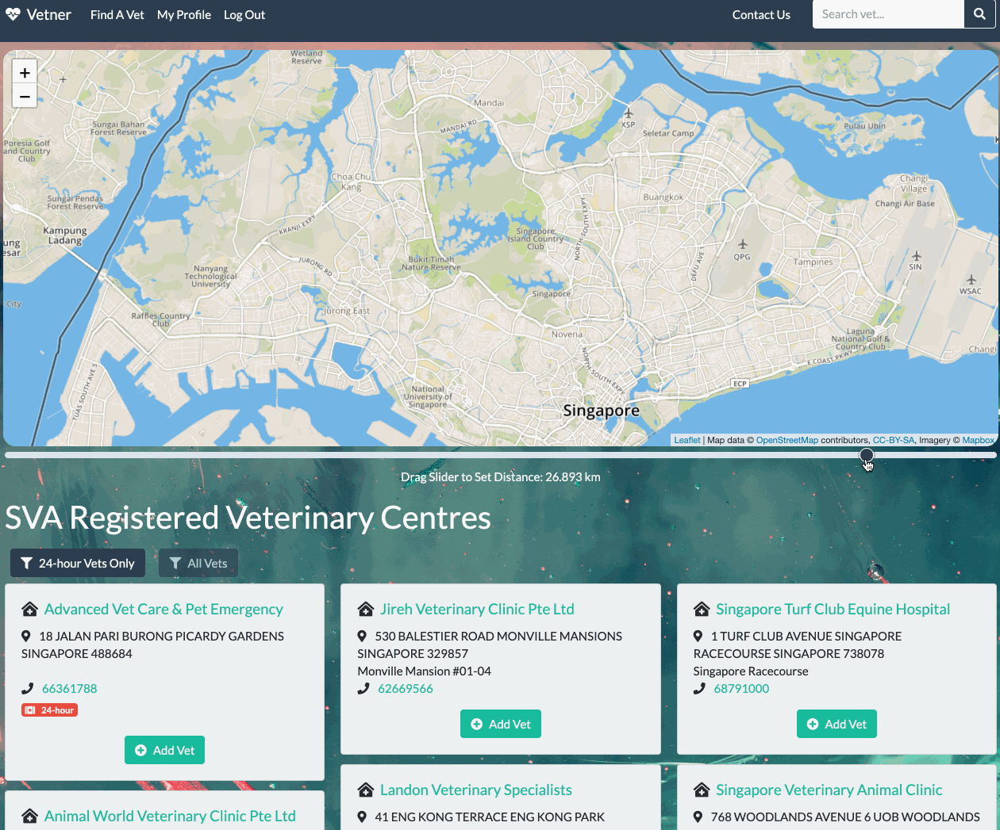

# Vetner

## Overview
Vetner is a Ruby on Rails platform that helps pet owners in Singapore connect with Singapore Veterinary Association registered clinics, manage their pets' medical history, and collaborate with their preferred veterinarians. The application combines a searchable clinic directory with personal health records so that owners and vets share the same up-to-date information. Interactive maps powered by OneMap, Mapbox, and Leaflet make it easy to locate nearby clinics, while secure authentication ensures that pet owners and veterinary staff each see the tools tailored to their role.

## Demo



## Key Features
- **Interactive vet discovery map** – Explore clinic locations plotted on a Leaflet map that uses OneMap basemaps and Mapbox markers. Signed-in owners can filter clinics by walking distance using a slider that is pre-filled with travel times calculated from stored home coordinates, while everyone can filter for 24-hour emergency providers and run full-text searches by clinic name, address, or postal code.
- **Dual authentication flows** – Devise manages separate sign-in and sign-up paths for pet owners (`User`) and veterinary clinics (`Vet`). Onboarding automatically creates the corresponding profile records so each account can complete its details right after registration.
- **Owner profiles with location awareness** – Owners maintain contact details, upload a profile image via Active Storage, and save their address. Postal codes are validated through the OneMap API to capture latitude and longitude, which power distance calculations on the map and clinic pages.
- **Pet health records** – Owners can register multiple pets, attach photos, and log visit histories. Pet records store titles, visit dates, and narrative notes, giving both owners and authorised vets a timeline of care.
- **“My Vets” relationship management** – Owners can add clinics from the directory to a personal list. The association is bidirectional, so vets instantly see which clients and pets are linked to their practice when they sign in.
- **Vet clinic dashboard** – Veterinary users view their clinic profile, edit contact details, and see a tabular list of associated clients with phone numbers, pet types, and links to each animal’s record.
- **Contact and admin tools** – Prospective clinics can reach the team through a MailForm-powered contact form, while administrative users can access a RailsAdmin dashboard at `/admin` to manage data directly.

## Getting Started

### Prerequisites
- Ruby 2.5.1
- Rails 5.2.x
- PostgreSQL 9.1+
- Node.js and Yarn (for managing JavaScript and CSS assets bundled through the Rails asset pipeline)

### Installation
1. **Clone the repository**
   ```bash
   git clone https://github.com/reshinto/vetner.git
   cd vetner
   ```
2. **Install Ruby dependencies**
   ```bash
   bundle install
   ```
3. **Install JavaScript dependencies** (if Yarn reports "nothing to install" it simply means the existing packages are already satisfied)
   ```bash
   yarn install
   ```
4. **Configure environment variables**
   Create a `.env` file (the project uses `dotenv-rails` in development) and provide the credentials used by the app:
   ```dotenv
   GMAIL_USERNAME=your_email@example.com
   GMAIL_PASSWORD=your_email_password
   ONEMAPTOKEN=your_onemap_api_token
   MAPBOXTOKEN=your_mapbox_api_token
   ```
   These values support the contact form (SMTP delivery) and the map integrations.
5. **Set up the database**
   ```bash
   rails db:create
   rails db:migrate
   ```
6. **(Optional) Seed sample data**
   ```bash
   rails db:seed
   ```
   Seeding creates admin users, example pet owners, and a catalogue of clinics with location data fetched from OneMap.

### Running the Application
Start the Rails server and visit `http://localhost:3000` in your browser:
```bash
rails server
```

### Accessing Admin Tools
If you seeded the database, sign in with one of the generated admin accounts and navigate to `http://localhost:3000/admin` to manage records through RailsAdmin.

## Project Structure Highlights
- `app/models` – ActiveRecord models for users, vets, profiles, pets, and pet records, including the `VetProfile.search_vet_profiles` full-text search scope powered by `pg_search`.
- `app/controllers` – RESTful controllers coordinating authentication, profile management, pet CRUD operations, vet relationship actions, map feeds, and the contact form.
- `app/views` – ERB templates for the landing page carousel, Leaflet map, profile dashboards, pet record tables, and modal forms used across the site.
- `config/routes.rb` – Declares Devise routes for both account types, the resource endpoints, custom actions for linking vets to users, contact form routes, and the mounted RailsAdmin engine.
- `db/seeds.rb` – Populates example accounts and clinic data (including emergency flags and coordinates) to explore the app without manual entry.

## Testing and Development Notes
- Use `rails test` to execute the default test suite.
- Active Storage is configured for local disk storage by default; update `config/storage.yml` if you plan to use a different service in production.
- Map features rely on browser `sessionStorage` for caching distance calculations. Clear site data if you need to reset cached values during development.

## Contributing
1. Fork the repository and create a feature branch.
2. Follow the existing Ruby style conventions (Ruby 2.5, Rails 5.2) and keep views accessible and responsive (Bootstrap 4).
3. Run the test suite and linting tools relevant to your changes.
4. Submit a pull request describing the update, including screenshots for UI changes when possible.

## License
This project is provided for educational purposes. Please contact the maintainers before using the code for commercial deployments.
